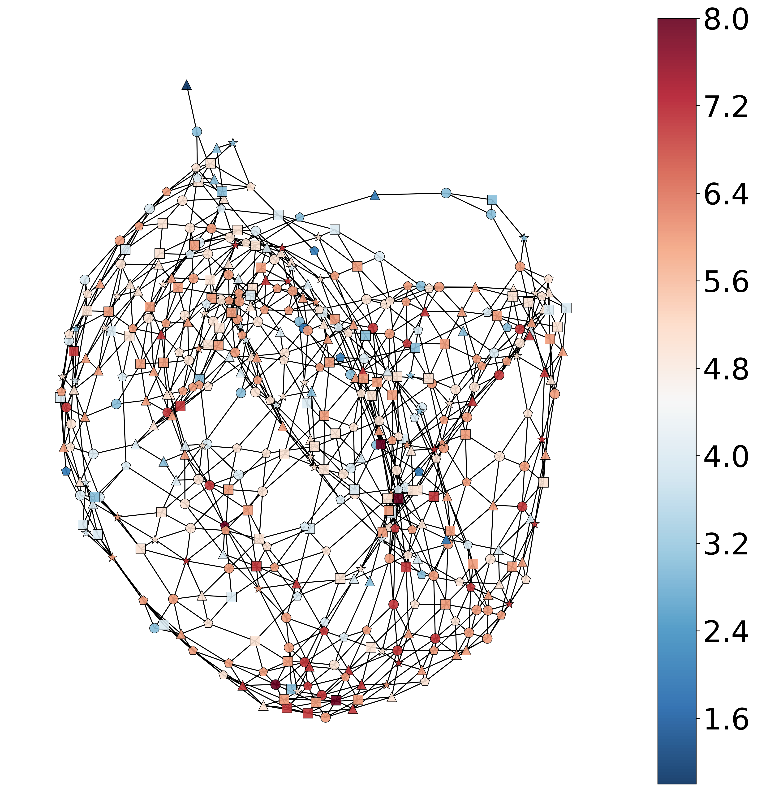

# coor2graph

**coor2graph** is a software tool for converting coordinate data into graph representations and performing graph analysis.

It generates adjacency matrices from coordinate files obtained from molecular dynamics simulations, stochastic simulations, lattice models, and other sources. These matrices are subsequently used with the Python library [NetworkX](http://networkx.org/) to compute graph measures and analyze complex networks.

The software also supports periodic boundary conditions (PBC), allowing their effects on graph connectivity and network measures to be investigated.


## Features

- Conversion of coordinate data into graph representations.
- Generation of adjacency matrices based on interatomic or intersite distances.
- Graph analysis using NetworkX.
- Support for periodic boundary conditions.
- Processing of coordinate trajectories.


### Available Options

- [x] pair
- [ ] triad
- [ ] 2D lattice
- [ ] 3D lattice
- [ ] Non-cubic pbc

## Requirements

The software uses CMake as its build system.

### Supported compilers

1. GNU Fortran (gfortran)
2. Intel Fortran (ifort)

### Build system

The build system requires CMake 3.30.3 or newer and GNU Make.

To build `coor2graph`, run:

```bash
cmake -B build -DBUILD_STATIC=ON
make -C build
```

## Python depencies

Graph analysis is performed using the Networrkx Python library.

Required Python packages:
- numpy
- pandas
- networks
- matplotlib
- scipy (form large matrix operations, when required)

## Alternative: Pytnon environment
A dedicated Conda environmenr can be created using:

```bash
conda create --name myenvironment pyhton=3
conda activate myenvironment
```


## Graph measures

Graph measures are computed using NetworkX.

Currently considered graph measures include:

- Degree centrality

    degree
    in_degree
    out_degree

- Eigenvector centrality

    eigenvector
    katz

- Closeness centrality

    closeness
    incremental_closeness

- Current-flow closeness

    flow_centrality
    information

- Betweenness centrality

    betweenness
    betweenness_subset
    edge_betweenness

- Current-flow betweenness

    flow_betweenness
    edge_flow_betweenness

- Other measures

    harmonic_centrality
    dispersion
    laplacian


### How to use?

### Basic use
```coor2graph --input <file>.gro --rcut <#> --pbc <y|n> --pair <sym1> <sym2> <distance>```

If `--net` is set to `y`, the `process_all.py` script is executed to perform graph analysis using NetworkX.

The following parameters are passed to the script:

- `nframes`: Number of frames to process.
- `ncores`: Number of CPU cores to use.
- `measure_type`: Type of graph measure to compute.
- `measure_name`: Name of the graph measure.
- `draw_freq`: Frequency at which graphs are generated.

These parameters can be provided interactively through standard input or read from a file using input redirection (`< filename`).

### Basic use

```coor2graph --input <file>.gro --rcut <#> --pbc <y|n> --pair <sym1> <sym2> <distance> --net <y|n>```


### GRO file format

```
MD of 9 ising spins, t= 0.0
    9
    1ISING  SP1    1   0.000   0.000   0.000  0.0000  0.0000  0.0000
    2ISING  SP1    2   0.100   0.000   0.000  0.0000  0.0000  0.0000
    3ISING  SP1    3   0.200   0.000   0.000  0.0000  0.0000  0.0000
    4ISING  SP1    4   0.000   0.100   0.000  0.0000  0.0000  0.0000
    5ISING  SP1    5   0.100   0.100   0.000  0.0000  0.0000  0.0000
    6ISING  SP1    6   0.200   0.100   0.000  0.0000  0.0000  0.0000
    7ISING  SP1    7   0.000   0.200   0.000  0.0000  0.0000  0.0000
    8ISING  SP1    8   0.100   0.200   0.000  0.0000  0.0000  0.0000
    9ISING  SP1    9   0.200   0.200   0.000  0.0000  0.0000  0.0000
   0.40000   0.40000   0.40000
```
Positions (x,y,z) and box(3) units in nm


#### Example (Ising model)
First-neighbor interaction


#### Degree centrality
2d Lennard-Jones fluid at NVT ensemble
<p align="center">
  
</p>

#### Closeness centrality


#### Example (3-sites water model)


#### Properties along a trajectory


### PBC effects on centrality degree
(with pbc conditions)

(without pbc conditions)


